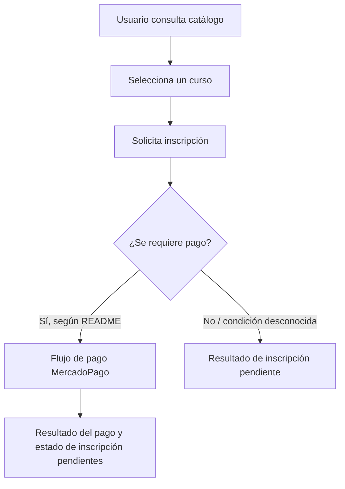
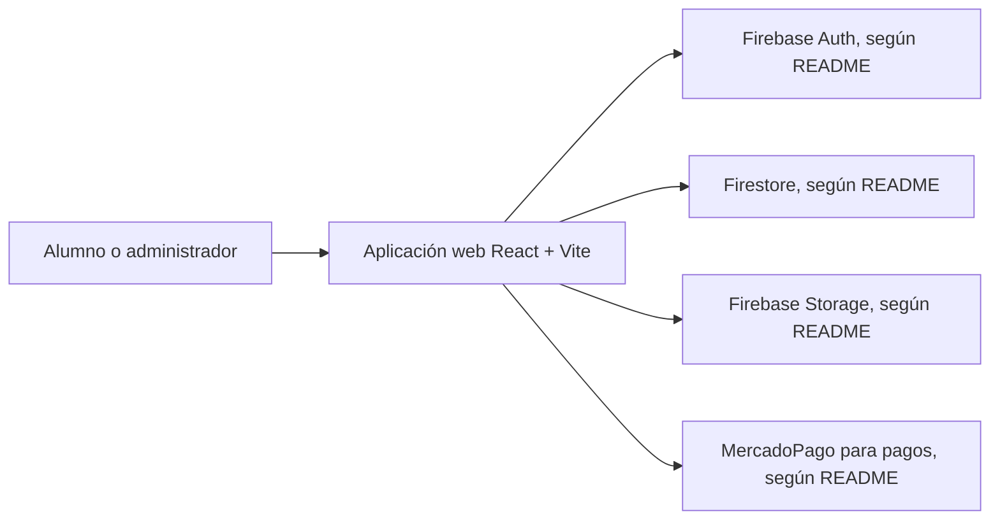

# 04 — Diagramas funcionales

Los siguientes flujos son **[Inferido]** a partir de las capacidades descritas en `README.md`; no son una especificación confirmada de pantallas, servicios ni estados. Revisar el código antes de usarlos como contrato.

## Inscripción declarada

## Componentes mencionados en README

Las conexiones reflejan únicamente integraciones nombradas por el README. La arquitectura y la implementación de cada conexión quedan [Pendiente] de corroboración en el código.
